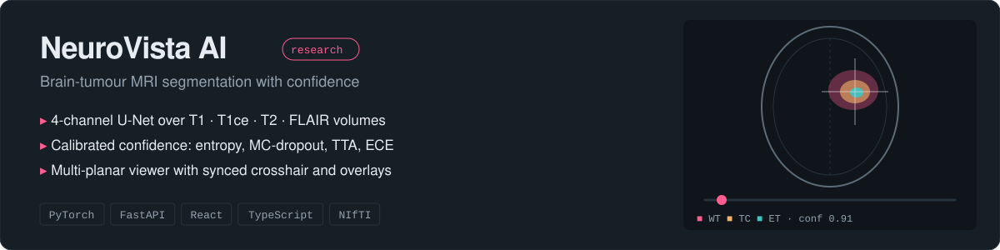

  
  
  
  

### `> ls ./projects --live`

8 projects · 3 deployed · click a card for the code

  

  
  

  
  

  

  

  

  

  
  

### `> cat stack.json`

   
   
  

<table>
<tr>
<td width="50%" valign="top">

**📡 real-time**  WebSockets · Canvas API · Chart.js · live dashboards  
**🧠 ml &amp; data**  XGBoost · SHAP · Hugging Face · ArcFace · Pandas · Power BI / DAX  
**🧪 mlops**  MLflow · DVC · Jupyter

</td>
<td width="50%" valign="top">

**💼 Aptpath** · Python Dev Intern · *Jul–Aug 2025*  
NLP meeting summarizer on BART/T5 → latency **3 s → 1.2 s**

**📊 Cognifyz** · Power BI Intern · *Oct–Dec 2024*  
5+ dashboards over 10k+ records → load time **−35%**

</td>
</tr>
</table>

### `> git log --graph --stats`

  

<picture>
  <source media="(prefers-color-scheme: dark)" srcset="https://raw.githubusercontent.com/ruchirachowdary-1836/ruchirachowdary-1836/output/snake-dark.svg">
  
</picture>

<b>🛰️ achievements</b>

 

- 🚀 Participant, **NASA Space Apps Challenge 2025**
- 🧠 Selected for the **9th Summer School of Artificial Intelligence**
- ⚔️ Active competitive programmer (**Code Quest**)

  <code>3/3 ✓ recognised</code> · thanks for stopping by · <code>ws.close(1000, "see you soon")</code>

